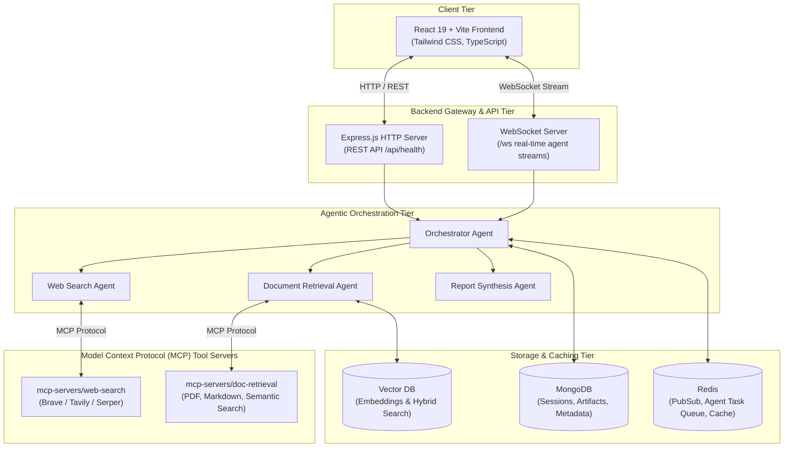

# InsightForge-AI Architecture

InsightForge-AI is an end-to-end agentic AI research platform designed to automate deep information retrieval, synthesis, and knowledge verification across disparate web and document corpora.

## System Architecture Diagram

## Directory Mapping

- **`/frontend`**: React 19 application powered by Vite, Tailwind CSS, and TypeScript.
- **`/backend`**: Modular Node.js + Express + TypeScript service handling API routing, WebSocket sessions, and agent orchestration.
- **`/mcp-servers`**: Modular tool servers adhering to the Model Context Protocol standard.
- **`/docker`**: Multi-container Docker Compose definitions for reproducible local orchestration.
- **`/docs`**: Architectural specifications, schematics, and configuration guides.
