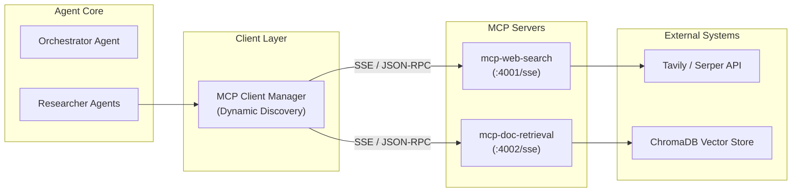

# Model Context Protocol (MCP) Architecture in InsightForge-AI

This document explains the architectural rationale behind using the **Model Context Protocol (MCP)** for agent tool access in InsightForge-AI, comparing it against conventional direct/hardcoded function calls.

---

## 1. Executive Summary

In early iterations of AI agent platforms, tools are commonly implemented as direct internal function imports (e.g., `import { search } from './search'`). While simple to start, this pattern creates tightly coupled monoliths that cannot scale across language ecosystems, container boundaries, or distributed enterprise microservices.

InsightForge-AI refactors all agent tool interactions (`web_search`, `retrieve_context`) through the **official Model Context Protocol (MCP) SDK** over HTTP Server-Sent Events (SSE). 



---

## 2. Hardcoded Function Calls vs. MCP Tool Servers

| Architectural Criterion | Direct Function Calls (Legacy) | Model Context Protocol (MCP) |
| :--- | :--- | :--- |
| **Coupling** | **Tight**: Agent logic directly depends on database drivers and API SDKs. | **Decoupled**: Clean protocol boundary separating reasoning agents from tool runtime. |
| **Discovery** | **Static**: Tool schemas and signatures are hardcoded in agent prompts. | **Dynamic**: Agent queries `client.listTools()` at runtime to discover capabilities. |
| **Swappability** | **Difficult**: Swapping search providers requires refactoring agent code. | **Seamless**: Replace server implementation without altering agent logic. |
| **Deployment** | **Monolithic**: All tool dependencies must run in the backend container. | **Microservices**: Tools run as independent Docker containers with dedicated scaling. |
| **Polyglot Support** | **Language-locked**: Agent and tools must share the same runtime. | **Language-agnostic**: Agents in TypeScript can invoke tools in Python, Go, or Rust. |
| **Observability** | **Ad-hoc**: Each function manually logs or instruments traces. | **Standardized**: Middleware intercepts every tool call with latency and telemetry. |

---

## 3. Core Architectural Benefits

### A. Dynamic Tool Discovery (`listTools`)
Instead of hardcoding what tools a researcher agent has access to, the backend connects to MCP servers at startup and dynamically inspects available tools:
```typescript
const toolsResult = await client.listTools();
// Dynamically registered: ['web_search', 'retrieve_context']
```
When new tools are deployed to an MCP server, agents gain immediate access without backend code redeployments or schema edits.

### B. Swappable Implementations Without Agent Refactoring
Consider `web_search`:
- In production, it can query Tavily or Serper.
- In offline environments or staging tests, it falls back to local knowledge or DuckDuckGo.
- The Researcher Agent only knows the tool contract (`web_search(query: string)`), making the underlying provider swappable at configuration time.

### C. Standardized Tracing & Telemetry
Because all tool calls flow through `MCPClientManager.callTool()`, every call is automatically measured and persisted into MongoDB's `AgentTrace` collection:
- `tool`: Name of the tool invoked (`web_search`, `retrieve_context`)
- `arguments`: Input parameters passed by the LLM
- `durationMs`: Wall-clock execution latency
- `output`: Number of items returned and result excerpt
- `timestamp`: Chronological trace order

---

## 4. How to Explain This in an Interview

> *"When designing InsightForge-AI, we decoupled agent reasoning from tool execution using the Model Context Protocol (MCP). Rather than binding researcher agents directly to our database driver or external search SDKs, we implemented standalone MCP servers exposing `web_search` and `retrieve_context` over Server-Sent Events.*
>
> *This provided three concrete engineering wins:*
> 1. *First, **dynamic discovery**: Our orchestrator queries available tools at runtime, so we can hot-plug new capabilities without touching agent prompts.*
> 2. *Second, **containerized scalability**: The document retrieval service can scale independently on GPU/memory-optimized nodes for vector search, while the backend API remains lean.*
> 3. *Third, **uniform telemetry**: We intercept all tool invocations through the MCP client, recording latencies, inputs, and outputs into our `AgentTrace` reasoning graph for complete observability."*
